# 👋 ¡Hola! Soy Joaquín

**Desarrollador Full Stack IA** · LLMs, agentes y evaluación de calidad

Trabajo como externo para **Air Europa** construyendo aplicaciones con LLMs de punta a punta, del backend y la nube a la interfaz. Técnico Superior en DAM y DAW, ahora cursando un Máster en **Inteligencia Artificial, Cloud Computing y DevOps**.

## 🧠 Qué hago

- **Agentes y backends con LLMs** en Python (FastAPI) y TypeScript: LangGraph, LangChain, Vercel AI SDK, MCP y tools.
- **Evaluación de calidad** de RAG y LLMs: métricas de recuperación como MRR y Recall, fundamentación, relevancia y LLM-as-a-Judge, con trazas en Langfuse.
- **Seguridad de LLMs**: guardrails y evaluaciones de seguridad con NeuralTrust.
- **Cloud en AWS**: Bedrock, S3, S3 Vectors y RDS.
- **Frontends** con React, Redux Toolkit, Vite y Vitest.

## 🛠️ Stack

| Área | Tecnologías |
| --- | --- |
| **IA y LLMs** | 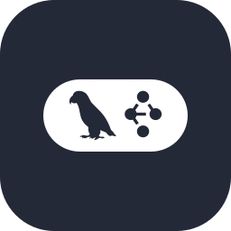 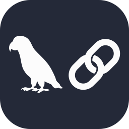 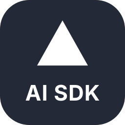 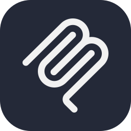 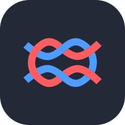 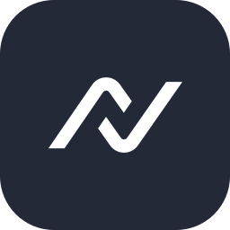 |
| **Datos y ML** |  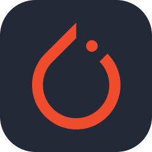 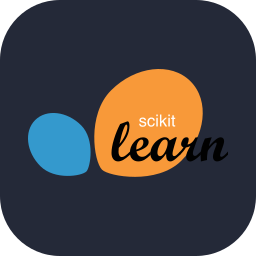  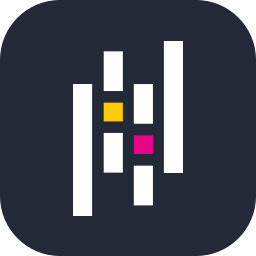 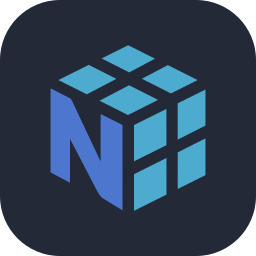 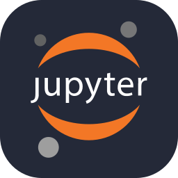 |
| **Backend** | 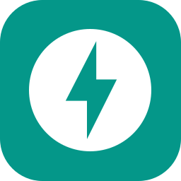 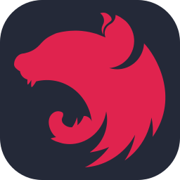  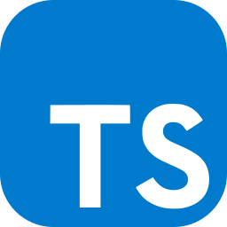  |
| **Frontend** |  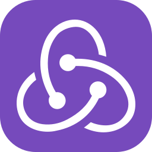 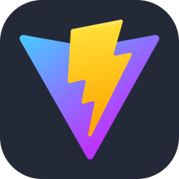   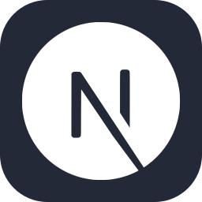  |
| **Cloud y DevOps** |  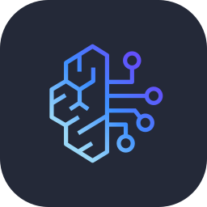 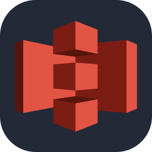   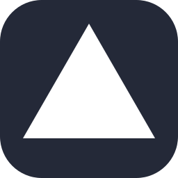 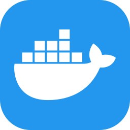  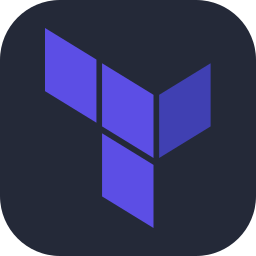 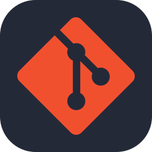 |

## 📊 Lenguajes más usados

## 🐍 Mis contribuciones

<picture>
  <source media="(prefers-color-scheme: dark)" srcset="https://raw.githubusercontent.com/Joakamakaka1/Joakamakaka1/output/github-contribution-grid-snake-dark.svg" />
  <source media="(prefers-color-scheme: light)" srcset="https://raw.githubusercontent.com/Joakamakaka1/Joakamakaka1/output/github-contribution-grid-snake.svg" />
  
</picture>

## 📬 Contacto

